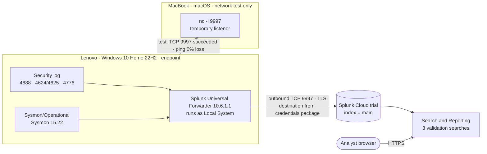

# Architecture (Item 08)

The Lenovo is the only endpoint. Its forwarder opens one **outbound** encrypted connection to Splunk Cloud on TCP 9997. No inbound port is opened on the laptop. The MacBook took part only in a one-off reachability test.

## Connections

| From | To | Port / protocol | Direction | Purpose | Verified |
|---|---|---|---|---|---|
| Universal Forwarder (Lenovo) | Splunk Cloud input host | TCP 9997, TLS | Outbound from the Lenovo | Event forwarding | `TcpTestSucceeded : True`; `list forward-server` shows one active forward |
| Analyst browser | Splunk Cloud web | HTTPS | Outbound | Searching | Searches ran |
| Lenovo | MacBook | TCP 9997 and ICMP | Test only | Client-isolation check | TCP succeeded, ping 0% loss, TTL 64 (same subnet, no router hop) |

## Design decisions

- **Inputs:** only `WinEventLog://Security` and `WinEventLog://Microsoft-Windows-Sysmon/Operational`, in the classic text format (`renderXml = false`). Splunk then extracts `EventCode` and `LogName` without an add-on.
- **Destination:** Splunk Cloud trial (14 days, 5 GB/day). The address and TLS certificate come from the credentials package, not from typed settings.
- **Why not the MacBook as SIEM:** Splunk Enterprise has no macOS support, so the MacBook is the analyst workstation, not the server.
- **Network verdict:** the Wi-Fi network does **not** isolate clients. The two machines can reach each other, which Project 06 needs.
