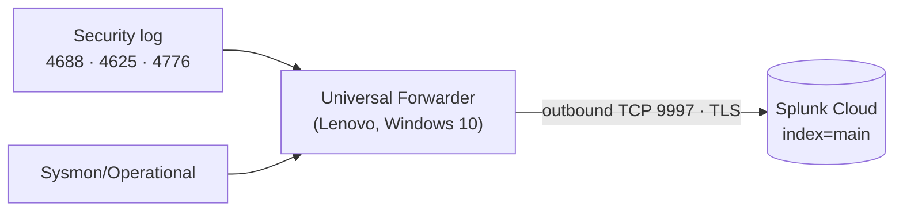

# Project 00 — Windows Endpoint Telemetry into Splunk Cloud

I built and validated a pipeline that sends Windows Security and Sysmon logs from a Windows 10 laptop to Splunk Cloud. I then proved the events arrive unchanged and answer real questions. Along the way I found and fixed a Sysmon configuration that was silently blocking every executable on the machine.

**Skills shown:** Windows audit policy · Sysmon · Splunk Universal Forwarder · SPL · end-to-end log validation · troubleshooting · evidence handling

## Architecture

Full diagram, ports and directions: [`architecture.md`](architecture.md)

## Results

| What I proved | Result |
|---|---|
| Command lines are captured | Event 4688 shows `cmd.exe /c echo cmdline-test` |
| Failed logons are correlated | 3 test attempts → 3 pairs of 4625 + 4776, each in the same second |
| Only the intended logs are sent | Exactly 2 sources in 24 h: Sysmon (103,829 events) and Security (5,975) |
| The pipeline doesn't distort data | One marked event: same time (13:48:36), host and EventCode (4688) in PowerShell and in Splunk |
| The data answers questions | 3 validation searches; 7 failed logons found, read and explained (3 from my test, 4 benign) |
| A broken sensor config was fixed | Sysmon Event 27 root cause found, one-setting fix, 0 block events afterwards |

Full write-up: [`report.md`](report.md)

## Folder contents

| Path | Contents |
|---|---|
| `report.md` | Full 13-section project report |
| `architecture.md` | Diagram, ports and data flow |
| `baseline.md` | Endpoint state before and after |
| `commands/` | `baseline.ps1`, `enable-cmdline-4688.ps1`, baseline output, audit policy before/after |
| `sysmon/` | `sysmon-lab.xml`, the configuration in use |
| `splunk/` | `inputs.conf` (two inputs only), `searches.spl` (three validation searches) |
| `sentinel/` | `feasibility.md`: why Sentinel moves to Project 05 |
| `troubleshooting/` | Sysmon Event 27/28 case: write-up plus before/after evidence |
| `screenshots/` | Evidence images (captions below) |

## Screenshots

| File | Shows |
|---|---|
| `2026-11-18_project01_4688-cmdline.png` | Process creation event with the full command line |
| `2026-11-18_project01_4776-4625-failed-logon.png` | Three failed-logon tests, each with a matching credential-validation event |
| `2026-11-19_project01_network-path.png` | Lenovo → MacBook reachability test (IPs masked) |
| `2026-11-19_project01_cloud-reach-9997.png` | Lenovo → Splunk Cloud on TCP 9997 succeeded |
| `2026-11-19_project01_uf-forwarding.png` | Forwarder shows one active forward and no inactive ones |
| `2026-11-19_project01_splunk-sources.png` | Exactly two sources arriving: Security and Sysmon |
| `2026-11-19_project01_e2e-source.png` | The marked test event at the source (PowerShell) |
| `2026-11-19_project01_e2e-splunk.png` | The same event in Splunk |
| `2026-11-19_project01_spl-4688.png` | Search 1, unfiltered: process creation events arrive. The top row predates the command-line fix, so its command line is empty |
| `2026-11-19_project01_spl-sysmon1.png` | Search 2: Sysmon process creation |
| `2026-11-19_project01_spl-4625.png` | Search 3: failed logons counted per host |

## What I learned

A setting proves nothing until a test event proves it, and a count of events is not a finding until you read them. My failed-logon search returned seven events, but only three were my test. The other four were normal Windows and browser behaviour, and I'd only have known that by reading the messages.

## Limitations

- Lab trade-off: the forwarder runs as Local System.
- The Sysmon config is still very verbose; tuning is planned for Project 03.
- Splunk Cloud trial only. Sentinel was assessed but not deployed (see `sentinel/feasibility.md`).
